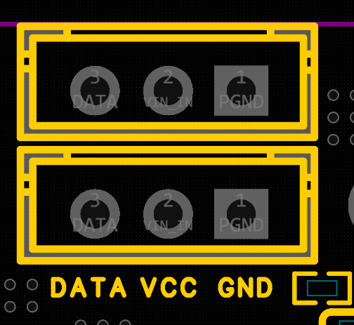
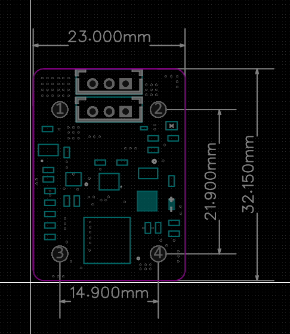
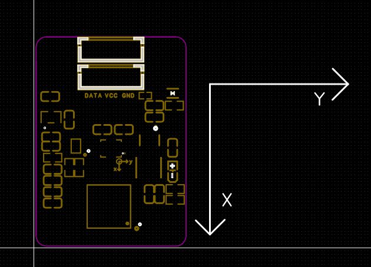

# IMU-DXL 舵机总线通信协议

版本：1.2  
适用对象：机器人控制器、舵机总线主机、上位机及第三方 SDK 开发者

## 1. 快速接入

设备提供两组并联的 DATA、VCC、GND 三线接口，便于串接兼容的单线 TTL 舵机总线。主控、IMU 与舵机必须共地。

### 1.1 接口定义



图1  接口定义（以图中文字正向为观察方向）

两组接口电气并联。按图中文字正向观察，每组接口从左到右依次为：**DATA、VCC、GND**。一组可接主控或上一设备，另一组可继续连接下一只舵机；两组没有输入、输出方向之分。

> **注意**：不要仅根据插头外形或线色判断线序。上电前应逐线确认 DATA、VCC、GND，避免电源与数据线接反。两个接口的 VCC 直接相连，不得接入两个不同电源输出。

### 1.2 机械尺寸



图2  板卡尺寸与安装参考；外形约 23.0 mm × 32.15 mm，安装设计以图中标注为准。

### 安装与使用建议

- 安装时为线束和插头预留拔插空间，不要只按 PCB 外形尺寸开孔。
- 将 IMU 刚性固定在机体主体上，避免安装在存在明显弹性或高频振动的位置。
- 记录板卡方向与机器人前、左、上的对应关系，并在控制软件中完成固定坐标变换。
- 上电后先保持机体静止，待 LED 结束初始化提示，再启用姿态闭环。

### 1.3 坐标系定义



图3  板卡坐标系（从元件面正视板卡）

按图3从元件面正视板卡时，**+X 轴沿板卡长边向下，+Y 轴沿板卡短边向右**。+Z 轴按右手坐标系确定，垂直于板卡并由元件面朝向观察者。

陀螺仪 Gyro X/Y/Z 与四元数姿态均使用该板卡坐标系。绕各轴的正旋转方向遵循右手定则：右手拇指指向轴的正方向，四指弯曲方向即为正旋转。

### 安装到机器人上的建议

- 如果希望机体坐标采用前、左、上，可将板卡 +X 对准机器人前方、+Y 对准机器人左侧；此时 +Z 指向机器人上方。
- 如果受结构限制而采用其他安装方向，应在控制器中配置一个固定安装旋转，将板卡坐标系转换到机体坐标系。
- 控制算法、标定记录和日志必须使用同一套轴定义；不要只交换欧拉角显示值来代替完整的坐标变换。

> **注意**：四元数描述的是三维旋转。需要调整安装方向时，应对四元数或旋转矩阵执行固定坐标变换，再计算欧拉角。

## 2. 产品定位

IMU-DXL 在单线 TTL 舵机总线上表现为一个只读的虚拟舵机设备。主控可以像访问普通舵机一样，通过设备 ID 查询姿态和角速度，无需使用独立的 IMU 串口协议。

设备同时兼容：

- 飞特 SCS/STS 协议
- DYNAMIXEL Protocol 2.0

设备不提供力矩、目标位置或速度控制功能。未列出的写指令和控制指令不会改变设备状态。

为兼容 DYNAMIXEL Wizard 2.0 扫描，DYNAMIXEL 2.0 的 PING 只读身份使用其数据库中
的型号 1030（XM430-W210）。这只是上位机发现兼容标识，不表示设备具备舵机控制或写入功能。

## 3. 接口参数

| 项目 | 参数 |
|---|---|
| 总线类型 | 单线半双工 TTL |
| 接口线数 | 电源、地、DATA，共3线 |
| 波特率 | 1,000,000 bit/s |
| 数据格式 | 8数据位、无校验、1停止位（8N1） |
| 设备 ID | 200（十六进制 `0xC8`） |
| 广播 ID | 254（十六进制 `0xFE`） |
| 支持指令 | PING、READ、SYNC_READ、DYNAMIXEL FAST_SYNC_READ（PING 支持单播和广播） |
| 默认状态 | 自动识别协议 |

接线时必须保证主控、IMU及同一总线上的舵机共地。DATA应连接到单线 TTL 总线，不可连接到RS-485差分接口。电源电压应遵循产品标注；使用外部电源时，避免多个电源输出直接并联。

## 4. 自动协议识别

上电后设备处于自动识别状态。收到第一个长度和校验均正确的帧后，设备选择对应协议：

- `FF FF FD 00`：DYNAMIXEL Protocol 2.0
- `FF FF ID LEN`：飞特 SCS/STS

协议选定后，在通信活跃期间保持不变。连续20秒没有有效通信后，设备返回自动识别状态，可以重新选择任一协议。

建议主控在建立连接后先发送一次 PING，再开始周期读取。推荐查询频率为10～50 Hz；总线上设备较多时，应使用 SYNC_READ。

## 5. IMU数据格式

所有多字节数值均为小端序。核心姿态数据长度为12字节：

| 偏移 | 长度 | 类型 | 名称 | 换算/说明 |
|---:|---:|---|---|---|
| 0 | 2 | `int16` | Gyro X | 原始值 ÷ 16.4 = °/s |
| 2 | 2 | `int16` | Gyro Y | 原始值 ÷ 16.4 = °/s |
| 4 | 2 | `int16` | Gyro Z | 原始值 ÷ 16.4 = °/s |
| 6 | 2 | IEEE-754 binary16 | Quaternion X | 四元数 X |
| 8 | 2 | IEEE-754 binary16 | Quaternion Y | 四元数 Y |
| 10 | 2 | IEEE-754 binary16 | Quaternion Z | 四元数 Z |

四元数采用 `W, X, Y, Z` 顺序表达旋转，但报文只传输 `X/Y/Z`。设备保证所选四元数半球满足 `W >= 0`，主机按下式恢复 W：

```text
W = sqrt(max(0, 1 - X*X - Y*Y - Z*Z))
```

由于 binary16 量化误差，恢复后建议再次归一化：

```text
n = sqrt(W*W + X*X + Y*Y + Z*Z)
W /= n; X /= n; Y /= n; Z /= n
```

如需欧拉角，可采用 ZYX 顺序：

```text
roll  = atan2(2*(W*X + Y*Z), 1 - 2*(X*X + Y*Y))
pitch = asin(clamp(2*(W*Y - Z*X), -1, 1))
yaw   = atan2(2*(W*Z + X*Y), 1 - 2*(Y*Y + Z*Z))
```

上述结果为弧度，乘以 `180/π` 可转换为角度。控制算法建议优先直接使用四元数，避免欧拉角在 Pitch 接近 ±90°时产生表示奇异。

## 6. 飞特 SCS/STS 协议

### 6.1 帧格式

请求帧：

```text
FF FF ID LENGTH INSTRUCTION PARAM... CHECKSUM
```

状态帧：

```text
FF FF ID LENGTH ERROR DATA... CHECKSUM
```

校验计算范围从 ID 到最后一个参数或数据字节：

```text
CHECKSUM = ~(ID + LENGTH + INSTRUCTION/ERROR + PARAM/DATA...) & 0xFF
```

### 6.2 PING

查询 ID 200：

```text
TX: FF FF C8 02 01 34
RX: FF FF C8 02 00 35
```

### 6.3 读取姿态

飞特完整 IMU 数据块位于地址56（`0x38`），长度15字节。

```text
TX: FF FF C8 04 02 38 0F EA
```

响应中的15字节数据定义如下：

| 数据偏移 | 长度 | 内容 |
|---:|---:|---|
| 0～11 | 12 | 核心IMU数据 |
| 12 | 1 | 采样序号低8位，循环计数 |
| 13 | 1 | 状态字节 |
| 14 | 1 | 保留，当前为0 |

状态字节定义：

| 位 | 含义 |
|---:|---|
| bit 0 | `1`：姿态解算尚未就绪；`0`：姿态有效 |
| bit 1～7 | 保留 |

响应总长度为21字节：

```text
FF FF C8 11 00 [15字节数据] CHECKSUM
```

主机应先验证帧头、ID、长度和校验，再使用数据。当状态 bit 0 为1时，不应把四元数用于闭环控制。

### 6.4 SYNC_READ

广播读取地址56、长度15，ID列表中包含200：

```text
TX: FF FF FE 05 82 38 0F C8 6B
```

多个设备同时读取时，将各设备 ID 按预期应答顺序追加在 `C8` 前后。IMU会等待排在它前面的设备完成状态应答，然后发送自己的状态帧。

## 7. DYNAMIXEL Protocol 2.0

### 7.1 帧格式

使用标准 DYNAMIXEL Protocol 2.0：

```text
FF FF FD 00 ID LENGTH_L LENGTH_H INSTRUCTION PARAM... CRC_L CRC_H
```

状态帧指令为 `0x55`，其后为错误字节和数据。CRC为标准 CRC-16，初值 `0x0000`，多项式 `0x8005`。发送和接收时应按 Protocol 2.0 规则处理字节填充。

### 7.2 PING

```text
TX: FF FF FD 00 C8 03 00 01 3B FA
```

PING状态帧返回：

- 型号编号：`1030`（`0x0406`，用于 DYNAMIXEL Wizard 2.0 发现）
- 固件版本：`3`

### 7.3 读取姿态

DYNAMIXEL兼容核心数据块位于地址124（`0x007C`），长度12字节：

```text
TX: FF FF FD 00 C8 07 00 02 7C 00 0C 00 AB D7
```

正常状态帧结构：

```text
FF FF FD 00 C8 LENGTH_L LENGTH_H 55 00 [12字节数据] CRC_L CRC_H
```

状态字节还可在地址143单独读取：

- bit 0 = 1：姿态解算尚未就绪
- bit 0 = 0：姿态有效

### 7.4 SYNC_READ

广播读取地址124、长度12，ID列表中包含200：

```text
TX: FF FF FD 00 FE 08 00 82 7C 00 0C 00 C8 A8 E4
```

多个设备同时读取时，应按主控期望的应答顺序排列 ID。IMU支持自己位于列表中的任意位置，并在前序设备完成应答后返回数据。

### 7.5 FAST_SYNC_READ

DYNAMIXEL Protocol 2.0 的快速同步读取指令为 `0x8A`，请求参数格式与
SYNC_READ 相同。机器人主控的 0.15.x 控制周期读取地址124、长度12，并将
IMU（ID 200）放在设备列表第一位。IMU发送共享状态包头及自己的数据块，
后续舵机直接向同一个状态包追加各自的数据块，从而只发生一次总线方向切换。

快速状态包使用广播 ID `0xFE`，且不执行 DYNAMIXEL 字节填充。每个设备块为：

```text
ERROR ID [DATA...] CRC_L CRC_H
```

其中各段 CRC 为到该段为止的累计 CRC；主控只需验证最终 CRC。本固件要求
ID 200 位于 FAST_SYNC_READ 列表首位，这与机器人主控的总线布局一致。

## 8. 推荐主控流程

1. 将总线配置为 `1 Mbps, 8N1`。
2. 主控默认处于接收状态，只在发送请求时驱动DATA。
3. 向 ID 200发送PING。
4. 收到有效状态帧后，按10～50 Hz读取姿态数据。
5. 对每帧验证ID、长度及校验或CRC。
6. 检查姿态就绪状态。
7. 解码陀螺仪和binary16四元数，恢复W并归一化。
8. 超时后允许重试一次；不要在上一个请求尚未结束时连续叠加请求。
9. 连续20秒没有通信后，重新发送PING建立会话。

推荐单次响应超时设置为60 ms。多数情况下响应会在数毫秒内返回，但USB转串口、操作系统调度及多设备应答顺序可能增加延迟。

## 9. 错误处理

- 无响应：检查供电、共地、波特率、设备ID、协议和半双工方向切换。
- 校验错误：丢弃当前帧，并从下一个合法帧头重新同步。
- 数据分片：串口一次读取不保证得到完整帧，必须使用流式缓冲解析。
- 状态未就绪：保持读取，但暂不将姿态用于控制。
- 四元数轻微超单位：这是binary16量化可能造成的正常现象，恢复W时必须对根号内数值限幅。
- Yaw漂移：六轴IMU没有绝对航向观测，Yaw适合作为短时间相对角度；长期航向控制需要外部参考。

## 10. LED状态速查

| 指示状态 | 含义 |
|---|---|
| 每2秒短闪1次 | IMU正常，等待总线协议 |
| 每秒短闪2次 | 已识别DYNAMIXEL Protocol 2.0 |
| 每秒短闪3次 | 已识别飞特SCS/STS协议 |
| 每秒短闪4次 | 最近发生总线、校验或发送错误 |
| 每500 ms闪1次 | 姿态解算初始化中 |
| 100 ms亮/100 ms灭 | IMU传感器初始化失败 |

错误提示在最后一次错误发生后保持约2秒，然后恢复当前协议状态。通信停止20秒后，指示灯返回等待模式。

## 11. 兼容性说明

- 同一总线上不得存在另一个 ID 200设备。
- 本设备是只读传感器，不响应舵机位置、速度、力矩及EEPROM写入指令。
- 控制器可使用标准飞特SCS/STS读操作，或DYNAMIXEL 2.0的READ、SYNC_READ与FAST_SYNC_READ，无需专用硬件接口。
- 设备坐标系与机器人机体坐标系可能因安装方向不同而不一致。机器人软件应配置固定轴映射或安装旋转补偿。

